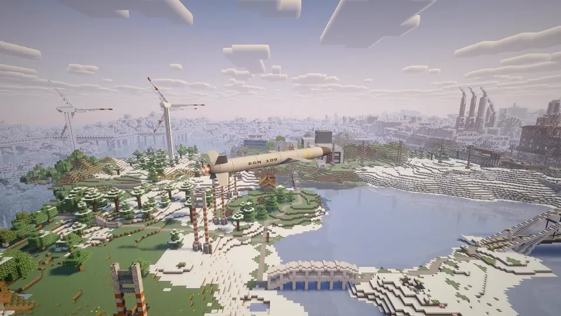
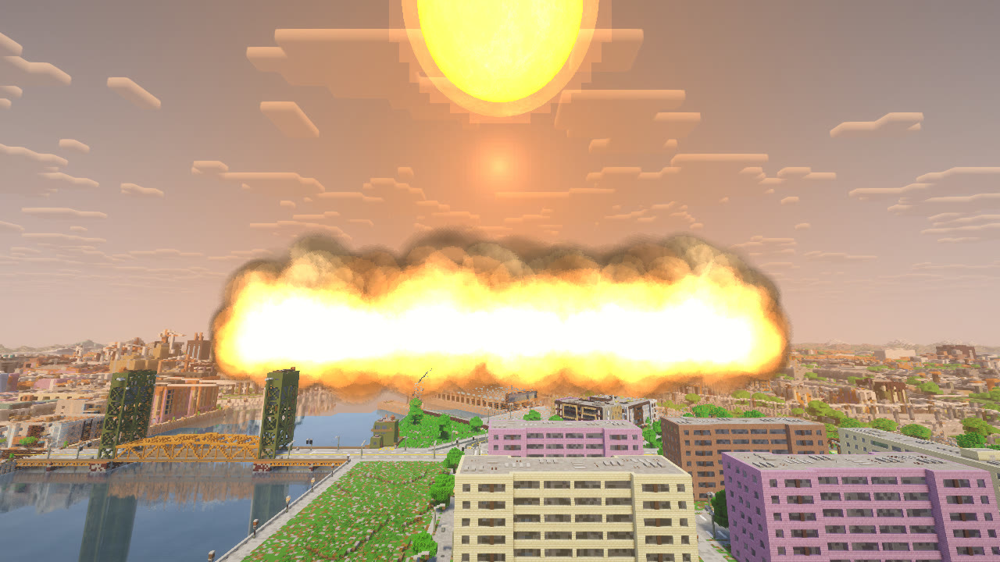

# Incoming

English · [Русский](README.ru.md)



A Minecraft 1.21.1 mod for NeoForge that adds modern air strikes and air defense. The weapons are a Shahed-style
kamikaze drone, a Lancet-style loitering munition, a cruise missile, a Grad-style rocket launcher, a B-2 with
a bunker-buster bomb and an ICBM with a nuclear warhead. A surface-to-air missile system shoots down drones, cruise
missiles and bombers.

Before version 3.0.0 the mod was called Airstrike. Worlds from those versions keep their Incoming blocks, items and
entities.



One block is one meter. Projectiles and launchers are built to real size, and the effects of a nuclear explosion are
calculated from reference data ([design notes](docs/DESIGN-nuke.md), in Russian).

## What it adds

- **Strike Designator.** One item aims and launches every weapon. Hold right-click to look through its binoculars
  (up to 400 blocks), pick the weapon with the mouse wheel and launch with left-click. Its console sets up a salvo
  of up to 30 projectiles spread over up to 150 blocks.
- **Targets.** Blocks, mobs, players and Create Aeronautics aircraft, including aircraft in flight. Another
  player, or an aircraft that is not yours, can only be targeted after you or your team have spotted it.
- **Targeting map.** Strikes anywhere within 10,000 blocks, with up to five waypoints for the drones and the cruise
  missile.
- **Projectile camera.** Watch a strike from the projectile and pick a new target on the way. The Shahed and the
  Lancet follow a moving target while you keep it in view.
- **Munitions.** Each launch uses a crafted munition item from your inventory.
- **Air defense.** Air raid sirens and on-screen warnings near the target. The surface-to-air missile system block
  shoots down drones, cruise missiles and the B-2.
- **Fixed launcher.** A block that launches a preset strike on a redstone signal.
- **Nuclear strike.** A 1 or 15 kt warhead on the ICBM, the cruise missile or the B-2: flash, fireball, mushroom
  cloud, a blast wave that ruins buildings as it passes, fires, and for a surface burst a crater and radioactive
  fallout. Operators only by default.
- **Blackout.** Destroying a transformer substation turns off the electric lights in its district.
- **Sound.** Engines and explosions are heard from kilometers away and arrive at the speed of sound, after the flash.

The [player guide](docs/guide/README.md) covers all of this in detail.

## Installation

1. Install Minecraft 1.21.1 with NeoForge 21.1.259 or newer. No other mods are required.
2. Download `incoming-<version>.jar` from [Releases](https://github.com/zentixua/incoming/releases/latest) and put it
   in the `mods` folder. Remove any older `incoming-*.jar` or `airstrike-*.jar`.
3. The server and every player need the same version of the mod. A client with a different version cannot join.

## Compatibility

All of these are optional:

- **Create Aeronautics** with **Sable** 2.0.6 or newer: aircraft can be targeted, and explosions break and push them.
- **Create**: munition recipes use Create parts when Create is installed and vanilla items otherwise.
- **Distant Horizons** 3.3 or newer: the targeting map shows distant terrain, and strike damage shows up in the
  distant terrain right away.
- **Sound Physics Remastered**: it handles muffling behind walls; Incoming only adds deafening from explosions.
- **Iris**: the nuclear effects render with shaders.
- **Flashback**: replays show strikes, and seeking through a replay does not set off explosions again.

## Player guide

- [Getting started](docs/guide/README.md) and all keys
- [Strike Designator](docs/guide/designator.md), [targeting map](docs/guide/map.md), [projectile camera](docs/guide/camera.md)
- [Weapons](docs/guide/weapons.md), [munitions and recipes](docs/guide/munitions.md), [strike rules](docs/guide/rules.md)
- [Air defense](docs/guide/defense.md), [fixed launcher](docs/guide/launcher.md), [nuclear strike](docs/guide/nuke.md), [blackout](docs/guide/blackout.md)
- [Commands](docs/guide/commands.md), [settings](docs/guide/settings.md), [FAQ and troubleshooting](docs/guide/faq.md)

## Building from source

Java 21 is required.

```sh
python3 tools/fetch_runtime_mods.py                # Create, Sable and Create Aeronautics for GameTest
cd mod
./gradlew build                                    # build and unit tests, jar in build/libs
./gradlew runGameTestServer -PmcModsDir=run/ci-mods
```

## Credits and license

Made by ZentixUA. Incoming is free software under the GNU General Public License version 3
([LICENSE](LICENSE)). You may use, modify and redistribute it, including in modpacks, under the same license and with
its source code. Sounds are made from Freesound recordings under CC0 and CC BY 4.0; the authors are listed in
[SOUND-CREDITS.md](SOUND-CREDITS.md). The jar bundles the sable-companion library (MIT).
