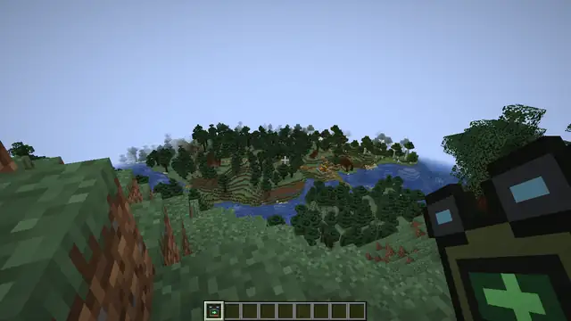

# Incoming: player guide

English · [Русский](ru/README.md)

Air strikes: Shahed drones, Lancets, cruise missiles, Grad rockets, a B-2 bomber and a nuclear ICBM. All of them are
aimed with one item, the Strike Designator. The projectiles are full size and fly like real ones; they can be seen and
heard from far away, and a siren sounds at the target before impact.

The mod used to be called Airstrike; its command is still `/airstrike`.

## Getting started

1. Craft a [Strike Designator](designator.md#crafting) and [munitions](munitions.md): the designator fires only what is
   in your inventory.
2. Hold RMB with the designator to look through its binoculars. Pick a weapon with the mouse wheel, aim, press LMB.
3. Press `N` to watch the strike through the projectile camera. Shift exits.

Shift+RMB opens the console (salvo, spread, target), and `,` opens the map for strikes at long range.

## Sections

| Section | What it covers |
|---|---|
| [Strike Designator](designator.md) | binoculars, console, projectiles on screen, abort |
| [Targeting map](map.md) | long-range strikes, flight route |
| [Projectile camera](camera.md) | onboard view, new target, Lancet |
| [Weapons](weapons.md) | how each one differs and when to use it |
| [Munitions and crafting](munitions.md) | recipes, what a launch uses |
| [Strike rules](rules.md) | who can be struck, spotting |
| [Defense](defense.md) | sirens, cover, SAM |
| [Fixed launcher](launcher.md) | a block that fires on a redstone signal |
| [Nuclear strike](nuke.md) | launch, detonation, survival, radiation |
| [Blackout](blackout.md) | substation and power cuts |
| [Commands](commands.md) | `/airstrike` |
| [Settings and keys](settings.md) | your settings, keys, world settings |
| [FAQ and troubleshooting](faq.md) | what the messages mean |

## Keys

| Where | Key | What it does |
|---|---|---|
| designator in hand | RMB (hold) | binoculars |
| in the binoculars | LMB / mouse wheel | launch / pick a weapon |
| designator in hand | Shift+RMB | console |
| in game | `,` | targeting map |
| in game | `N` | projectile camera; press again for the next projectile |
| in the projectile camera | LMB / Shift | new target / exit |
| on the map | LMB / Enter | pick a target / fire |
| on the map | Shift+LMB / RMB | add / remove a route point |
| near another player's nuclear launch | `.` | second key |

Keys are changed under Options → Controls → Key Binds → Incoming.
