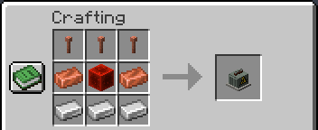

# Blackout

English · [Русский](ru/blackout.md)

A Transformer Substation powers an area with a radius of 512 blocks. Knock it out with a blast and the electric lights
of the area go out district by district. Power comes back by itself after 15 minutes.

- Lights on the grid go out: glowstone, lanterns, sea lanterns, redstone lamps, copper bulbs, shroomlights, froglights,
  end rods. Torches, candles and campfires keep burning.
- A nuclear strike cuts power across its whole radius, substation or not.
- The world is saved with ordinary lamps and opens without the mod. Only Create contraptions assembled in a dark
  district are better disassembled before you remove the mod.
