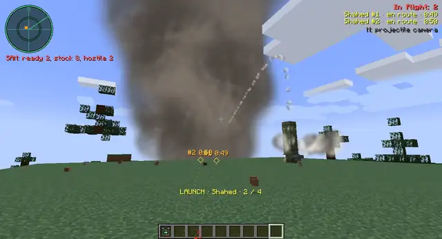
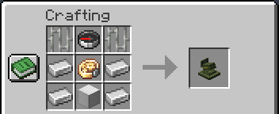
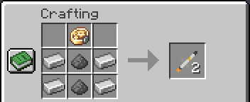

# Defense

English · [Русский](ru/defense.md)

## Sirens

Everyone within 350 blocks of the target hears a siren and sees a warning on screen before the strike. A nuclear strike
is announced to everyone within 20 km.

| Warning | Weapon | Before impact |
|---|---|---|
| ⚠ AIR RAID ALERT ⚠ | Shahed, Lancet, B-2 | 20–25 s |
| ⚠ MISSILE THREAT ⚠ | cruise missile, Grad | 15 and 8 s |
| ☢ MISSILE ATTACK ☢ | ICBM | 90 s, with a countdown |

Projectiles can be heard and seen from far away, up to 8 km. Sound travels at the speed of sound: a distant flash
shows up before you hear the explosion.

## Cover

A blast hits everyone within its radius, you included, and debris flies far.

- **Get underground.** Earth and thick walls stop a blast; underground and under water even glass stays intact.
  A strike close above or level with you still shakes dust and grit from the ceiling when the blast reaches you: a
  cruise missile on the street over a metro station brings it down in streams, a Grad rocket or a farther hit only a
  trickle.
- **The bunker buster** goes through about 30 blocks of stone and explodes inside. Only depth protects against it, or
  a SAM that shoots down the B-2.
- **Nuclear strike**: see [how to survive](nuke.md#how-to-survive).

## Surface-to-Air Missile System (SAM)

The SAM is a block that shoots down other players' Shaheds, Lancets, cruise missiles and B-2s by itself. It leaves the
projectiles of the player who placed it, and of that player's team, alone.

The block itself is the radar cabin. Four missile canisters stand upright on top of it, so the whole SAM is about five
and a half blocks tall. An interceptor leaves its canister straight up, then turns toward the target in a short arc.

- Its radar reaches 3 km and it fires from 1.5 km, one interceptor per target. About one in five misses.
- It does not shoot down ICBMs or Grad rockets. It does not see players, mobs or aircraft.
- It needs open sky above it and a player nearby: it does not work in an unloaded chunk.
- Its own side gets "Air raid alert!" with the direction to the target. Near the SAM, a radar screen appears in the
  corner of the screen.
- RMB on it with an empty hand shows how many missiles are ready and how many are in stock.

Against a SAM: a salvo (it has only four rails), a route around it, the hard-to-detect B-2, or the Grad.

### Crafting and loading

Interceptors are loaded with a right click or through a hopper, so a factory can keep the SAM supplied. They cannot be
taken out, but a broken SAM drops them along with itself.
