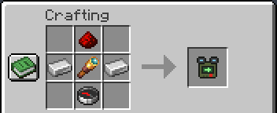
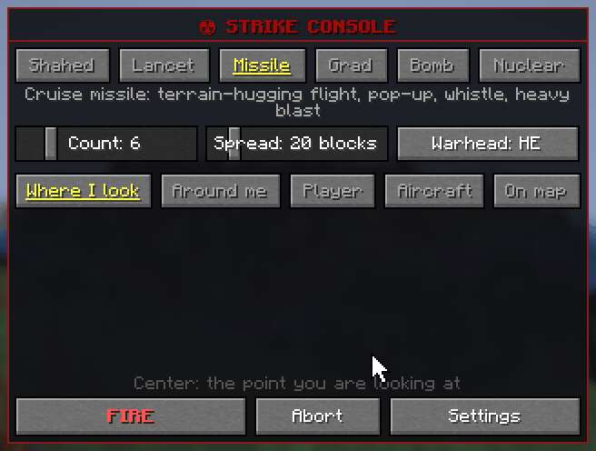
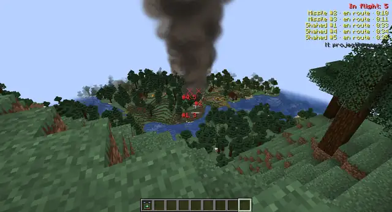

# Strike Designator

English · [Русский](ru/designator.md)

The designator aims and launches every strike: from its binoculars, from its console or from the [map](map.md).

## Crafting

Recipe: redstone dust on top; iron ingot, spyglass and iron ingot in the middle row; compass at the bottom.

In Creative mode the designator is in the Incoming tab. If the world owner has limited the designator to operators, it
does not fire for other players.

## Binoculars

- **RMB (hold)**: binoculars. The reticle shows what is under it and how far away it is. When it locks onto a mob, a
  player or an aircraft, the designator beeps.
- **Mouse wheel**: weapon (Shahed, Lancet, Missile, Grad, Bomb, Nuclear).
- **LMB**: launch.

The binoculars reach 400 blocks; farther away, strike [from the map](map.md). A nuclear launch follows a 3-second
countdown, and pressing LMB again cancels it.

## Console

Shift+RMB with the designator in hand. Here you choose how many rounds to launch, how widely to spread them and where.
The binoculars then fire with the same settings.

- **Weapon**: six buttons, each with a tooltip. The Missile and the Bomb also get a warhead button.
- **Count and Spread**: up to 30 rounds over up to 150 blocks from the center.
- **Target**: Where I look, Around me (where you stand, so step away first), Player (only [spotted](rules.md#spotting)
  players), Aircraft (Create aircraft nearby), On map.
- **FIRE**, **Abort** and **Settings**.

## Projectiles on screen

While your projectiles are in flight, a list in the top right corner shows each one's flight phase and time to impact,
and in the world every projectile carries a numbered mark with a dotted line to its target.

## Abort

The Abort button on the console calls off **your** strikes: projectiles self-destruct in the air without exploding, the
B-2 turns away, and unfired rounds of a salvo return to your inventory. A nuclear strike, Grad rockets in flight and a
dropped bomb still hit.
