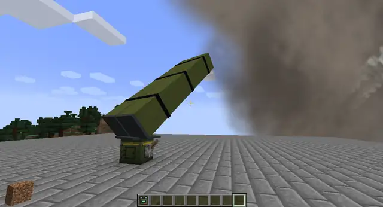
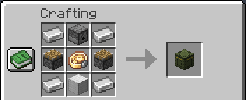

# Fixed launcher

English · [Русский](ru/launcher.md)

A block that launches Shaheds, Lancets, cruise missiles and Grad rockets by itself on a redstone signal. The designator
sets the target; a button, a lever or any circuit gives the order to fire. Several launchers make a battery on one
button.

## Loading

Place it in the open: buildings in front of the rack block the launch. Munitions go in with a right click or through a
hopper (and so from Create machines too); the stock has 9 slots. They come back out only when the block is broken. It
does not launch B-2s or ICBMs.

## Mission

1. RMB on the launcher with the designator links it to the designator (again to unlink).
2. Set the target, weapon and salvo on the designator and fire: while launchers are linked, the designator does not
   fire by itself but gives them a mission. The fire button on the console then reads MISSION.
3. The launcher turns toward the target and waits for a signal.

A mission target is a place no more than 10,000 blocks from the launcher; a player or an aircraft becomes the place
where it was at that moment. You can link only your own launcher or one belonging to your team (`/team`). To make the
designator fire by itself again, unlink all launchers.

## Firing

Each new redstone signal is one order: a single round or the mission's whole salvo. The rounds fly in the name of the
launcher's owner, even when the owner is offline, and Abort on the owner's designator calls them off. The launcher
fires only while its chunk is loaded, and never from an aircraft.

If the launcher clicks but does not fire, RMB on it with an empty hand shows why: no mission, not enough stock, the
previous order still running, or buildings blocking the launch sector.

## Crafting

Without Create, a clock takes the place of the precision mechanism.
