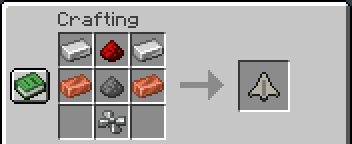
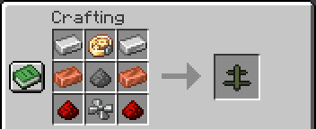
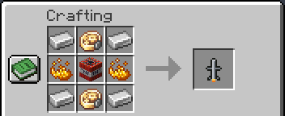
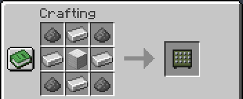
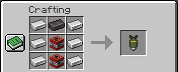
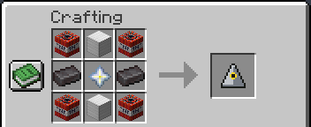
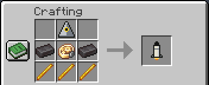

# Munitions and crafting

English · [Русский](ru/munitions.md)

The designator launches only what is in your inventory: one Shahed, Lancet, missile, bomb or ICBM is one item. Grad
rockets come in a pack of 40, and a salvo takes one rocket from the pack per shot.

- A salvo is paid for in full when you order it. If you are short, nothing launches, and a line above the hotbar shows
  how many you need and how many you have.
- If a launch fails or you [abort](designator.md#abort), unfired munitions return to your inventory.
- A nuclear warhead on a missile or bomb is one more item, the Nuclear Warhead.
- Creative mode needs no munitions.

## Recipes

Every recipe works on a crafting table or in a Create mechanical crafter, so munitions can be made in a factory. The
Incoming Pack includes JEI: hover over an item and press `R`. Without Create, a clock takes the place of the precision
mechanism (a comparator in the SAM Interceptor) and an iron trapdoor takes the place of the propeller.

| Munition | Recipe |
|---|---|
| **Shahed-136** |  |
| **Lancet Loitering Munition** |  |
| **Cruise Missile** |  |
| **Grad Rocket Pack** (40 rockets) |  |
| **Bunker Buster** |  |
| **Nuclear Warhead** |  |
| **ICBM** |  |

Other recipes: [Strike Designator](designator.md#crafting), [SAM and interceptors](defense.md#crafting-and-loading),
[fixed launcher](launcher.md#crafting), [substation](blackout.md). The Geiger Counter has no recipe; an operator gives
it out (`/give @s incoming:geiger_counter`).
