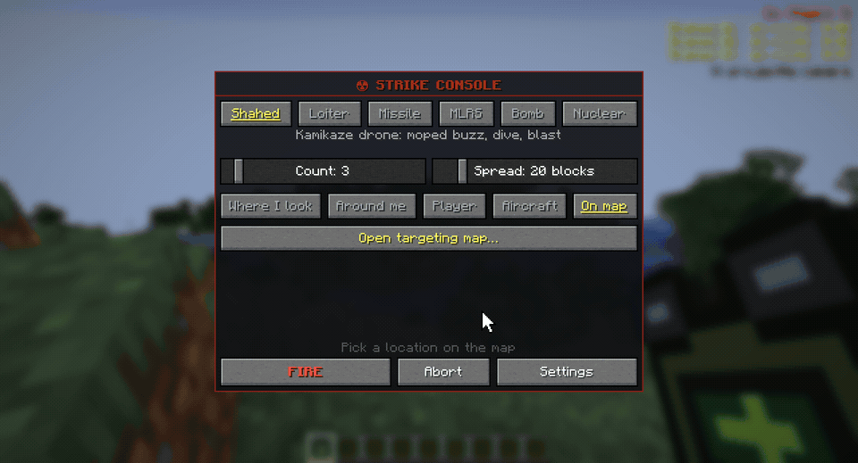

# Карта наведения

[English](../map.md) · Русский

Карта бьёт по любому месту до 10 000 блоков: за холм, в соседний город. Открывается клавишей `,` или с экрана пульта
(цель «На карте» → «Открыть карту наведения…»).

| Действие | Клавиша |
|---|---|
| выбрать место или чужого игрока | ЛКМ |
| сдвинуть карту / приблизить | тянуть ЛКМ / колесо мыши |
| вернуться к себе | пробел |
| поставить точку маршрута (до пяти) | Shift+ЛКМ |
| сдвинуть / убрать точку | тянуть точку / ПКМ по ней |
| выбрать точку пуска (оператор и хост) | Ctrl+ЛКМ или «Точка пуска…» и ЛКМ |
| сдвинуть / убрать точку пуска | тянуть значок / ПКМ по нему |
| огонь | Enter или «ОГОНЬ» |
| назад к пульту | Esc |

Удар идёт с оружием, числом снарядов и разбросом [экрана пульта](designator.md#экран-пульта). На карте видны твои
снаряды в полёте, игроки своей команды и чужие там, где их [видели](rules.md#разведка) последний раз.

## Маршрут

Шахед, крылатая ракета и «Ланцет» летят через точки маршрута: в обход ЗРК или чтобы зайти с нужной стороны. Внизу
видно длину маршрута и время полёта. Слишком длинный маршрут краснеет, и огонь не даётся. Без точек снаряд выбирает
путь сам. Остальное оружие маршрут не берёт.

## Точка пуска

Оператор или хост мира может выбрать, откуда взлетят снаряды: Ctrl+ЛКМ по карте или «Точка пуска…» и клик. Там
появится фиолетовый значок. При огне на этом месте встаёт пусковая, поворачивается к цели и стоит до
[Отбоя](designator.md#отбой); следующие удары с того же места идут с неё. Если чанк там не загружен, снаряды взлетают
с этого места без пусковой. Маршрут начинается от точки пуска, а внизу карты видно расстояние от неё до цели. B-2
заходит с её стороны, МБР всегда стартует со своей площадки. «Пуск от меня» возвращает пуск к тебе.

Точка пуска работает как маршрут: её берёт огонь с карты и с экрана пульта при цели «На карте», и она остаётся для
следующих ударов. Она должна быть не дальше 10 000 блоков от тебя. Другим игрокам кнопки не видно.

## Если карта пустая

Без Distant Horizons карта показывает только загруженные чанки, но ударить по пустому месту всё равно можно. В Незере
карта не работает.
