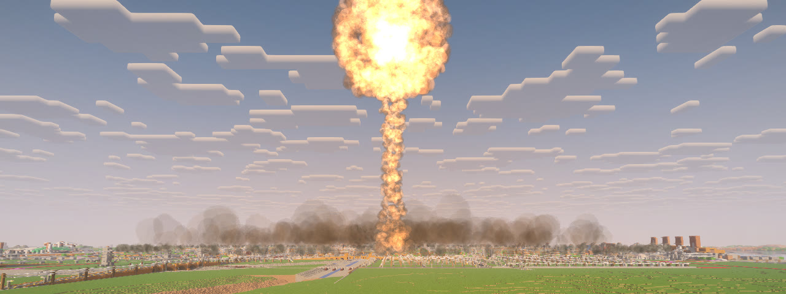
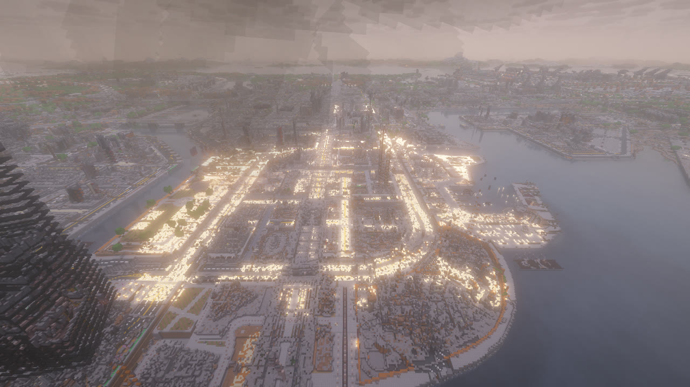

# Ядерный удар

[English](../nuke.md) · Русский

Ядерная боевая часть 1 или 15 кт на МБР, крылатой ракете или бомбе B-2: вспышка, гриб, ударная волна, пожары,
а при наземном подрыве — воронка и радиоактивный след. Радиусы — как у настоящего взрыва, блок равен метру.

## Как пустить

По умолчанию — только оператор.

1. Нужен предмет «МБР» или ракета либо бомба плюс «Ядерная боевая часть» ([рецепты](munitions.md#рецепты)).
2. На экране пульта: оружие «Ядерная» или кнопка «БЧ: ☢ ядерная» у ракеты и бомбы; мощность 1 или 15 кт; у МБР и ракеты
   подрыв воздушный (шире разрушения) или наземный (воронка и радиоактивный след), бомба рвётся под землёй.
3. ЛКМ в бинокле или «ОГОНЬ». Идёт отсчёт 3 секунды, повторный ЛКМ отменяет.

МБР стартует позади тебя и летит 90 секунд.

Если хозяин мира разрешил ядерку всем, игроку без прав оператора нужен второй ключ, когда в игре есть кто-то ещё:
другой игрок не дальше 16 блоков нажимает `.` за 30 секунд. Такой пуск видят все, и отменить его нельзя. Тревога у цели
идёт не меньше 90 секунд: ракета или B-2 с ядерной боевой частью стартуют через 90 секунд после её начала.

## Что будет

Всем ближе 20 км к цели заранее воет сирена. Потом вспышка, огненный шар и гриб. Саму ударную волну не видно. Ветер
сразу за ней поднимает то, что лежит на земле (пыль и землю, дым над горящим городом, брызги над водой), и катит вперёд
бурлящей стеной, как пыльную бурю. У 15 кт стена высотой около 150 м в 1 км от взрыва и около 50 м в 4 км; дальше она
редеет и сходит на нет около 9 км, где ветер уже не поднимает пыль. Вдали, а в дождь ближе, стена, как и гриб, тает
в дымке. В первые секунды огненный шар освещает верх стены оранжевым, даже днём. Волна ломает постройки, когда до них доходит: их
обломки летят вместе с пылью. Чем ближе стена, тем сильнее трясётся земля. Когда стена доходит до вас, взгляд отбрасывает от взрыва, а ветер за ней ещё качает вас.
После наземного подрыва за секунды до волны приходит короткий толчок по земле.

Огненный шар светит белым, по нему ходят пятна ярче и темнее, и, остывая, он желтеет и становится оранжевым. Он
поднимается и сворачивается в кольцо горячего газа — шапку гриба: это то же тело с первого мига. Сворачиваясь, он
смешивается снаружи с холодным воздухом, становится тёмно-красным, а потом бурым дымом. Пыль перед шаром закрывает его,
а его свет ложится на пыль и дым вокруг. Днём он ярче неба лишь первые несколько секунд, ночью его красное свечение
держится на несколько секунд дольше. Шапка — плотное облако из круглых клубов: сперва красно-бурое от окислов азота, за
минуту оно становится серо-белым, потому что в нём конденсируется вода. Пока облако поднимается, шапка катится: газ идёт
вверх посередине, наружу по верху и вниз снаружи, а клубы вспухают из неё и тонут обратно. Чем быстрее облако
поднимается, тем быстрее она катится; когда облако перестаёт расти, встаёт и шапка. Солнце освещает одну её сторону, а
складки между клубами остаются темнее. С земли в шапку поднимается столб пыли, а у его основания расходится юбка пыли.
Горящий город снизу освещает основание столба рыжим, а шапку высоко над ним — едва. Вдали, а в дождь ближе, гриб тает в
дымке.

За волной над городом минуту-две поднимается пелена пыли: у 15 кт — до 200 м высотой, к краю ниже. С крыши недалеко от
взрыва сперва видно, как волна идёт по городу, потом пыль накрывает и вас. Ночью её, как и верх стены пыли, оранжевым освещают
огненный шар и пожары (сторона стены от шара остаётся тёмной); её клубы светлее со стороны света и темнее в складках. В
самой густой видно
метров на 40, звуки глохнут. Пыль заполняет и долины вокруг города. Она оседает за несколько минут, её сносит ветром.
Там, где свет шара поджёг город, за несколько минут разгорается огненный шторм. Над горящими кварталами встают столбы
дыма, их клонит по ветру, а выше они сливаются в сплошной потолок дыма над городом. Ночью огонь подсвечивает его снизу
рыже-красным, зарево мерцает, а за пару километров видно, как город светится под своим дымом и отсвет ложится на пыль
вокруг. Несколько раз за первые десять минут над самым сильным огнём встаёт огненный смерч — на минуту-полторы — и бредёт
по пожару. Примерно с шестой минуты пожары стихают до тления, а к утру гаснут вместе с дымом. Если на сервере ядерные
пожары выключены (`nuclear.fires`), нет ни огненного шторма, ни мглы над городом. Вокруг сыплются пепел и обрывки горелой
бумаги.

У 15 кт волна убивает примерно до 0,4 км, свет шара обжигает до 3,4 км, окна вылетают до 6 км. У 1 кт всё в несколько
раз ближе. Наземный подрыв оставляет радиоактивный след по ветру с чёрным дождём. Осадки начинают выпадать примерно
через 7 минут после подрыва 15 кт, а дальше по ветру — позже.

Земля вокруг подрыва выжжена. Ближе к центру волна сдирает дёрн до голой земли. Дальше свет выжигает траву, цветы и
посевы пятнами и оставляет чёрную гарь там, где он сильнее всего, а трава, листва и вода вокруг желтеют, буреют и
сереют. Край рваный, а не кругом. Цвет выжженной земли остаётся навсегда, и в дальнем рельефе Distant Horizons тоже.

После удара МБР дальний рельеф Distant Horizons показывает руины самой разрушенной зоны, когда до них доходит волна:
сервер готовит их, пока ракета летит. У 15 кт дальний край этой зоны может появиться позже. После крылатой ракеты,
бомбы или `/incoming nuke now` дальние руины появляются через какое-то время после волны. Выбитые стёкла и поваленные
деревья дальше видны в дальнем рельефе, только когда подойдёшь ближе.

Вспышка метит и то, что осветила. Дерево, шерсть и сено лицом к шару пятнами обугливаются, а кирпич, бетон, каменные
кирпичи и песчаник темнеют от копоти. Игрок, моб, стойка для брони или лодка на свету оставляют на дереве или кладке
за собой светлую тень своей формы. Эти следы остаются, пока блок не сломают или не заменят. В тот же миг горящие
фонари и подстанции [электросети](blackout.md) коротят искрами, а трава, листва и дерево на свету начинают дымиться ещё
до прихода волны.

Над водой волна пыли не поднимает. Она бежит по воде тёмным кольцом ряби, за ним — стена брызг там, где ветер сильный,
а у центра вода белеет пеной. За волной воздух над водой вместо пыли наполняют белые брызги. За минуту они редеют,
а через три минуты их нет. Пыль, которую ветер несёт с берега на воду, остаётся бурой, а брызги, вынесенные на берег, —
белыми. Подрыв на воде или чуть над ней за несколько секунд выбрасывает полый столб воды — у 15 кт около километра
в высоту. Его верх раскрывается короной брызг, а секунд через десять его закрывает поднимающийся гриб. Сразу за волной
над водой на секунду-две встаёт тонкое белое облако конденсации. Потом столб сужается и секунд за двадцать падает
обратно в воду, а упавшая вода минутами катится во все стороны белой базисной волной. Это светлый туман: в густой его
части видно лишь метров на 50, и за четверть часа он рассеивается.

Вдали удар приходит резким двойным хлопком и глухим раскатом, а потом возвращается эхом от холмов, лесов и городов
вокруг: каждый склон, обращённый и к взрыву, и к вам, отвечает ему — чем дальше, тем позже. Животные вокруг подрыва на
несколько минут замолкают. В доме эхо такое же глухое, как сам удар. Мобы бегут от вспышки и ударной волны, потом
успокаиваются; ручные, с именем и на поводке остаются на месте, а в укрытии от волны мобы не бегут. Город горит ещё
минуты: слышно, как гудят пожары там, где горит, как рядом с ними ветер тянет в огонь, как рушатся руины поблизости,
и время от времени в горящих кварталах что-то взрывается.

## Как выжить

- **Под землю.** Природный грунт волна не трогает: пещеры и бункеры стоят, земля держит и свет, и радиацию.
- **Не смотреть на шар.** Свет убивает и обжигает только тех, кто под открытым небом видит шар.
- **Увидел вспышку вдали** — у тебя есть секунды до волны: за склон, в подвал, в яму.
- **Уйди из следа.** Пыль с одежды смывает вода (дождь не смывает). Лучевая болезнь начинается позже и молоком
  не лечится.

Счётчик Гейгера в руке щёлкает и показывает дозу. Его выдаёт оператор.
